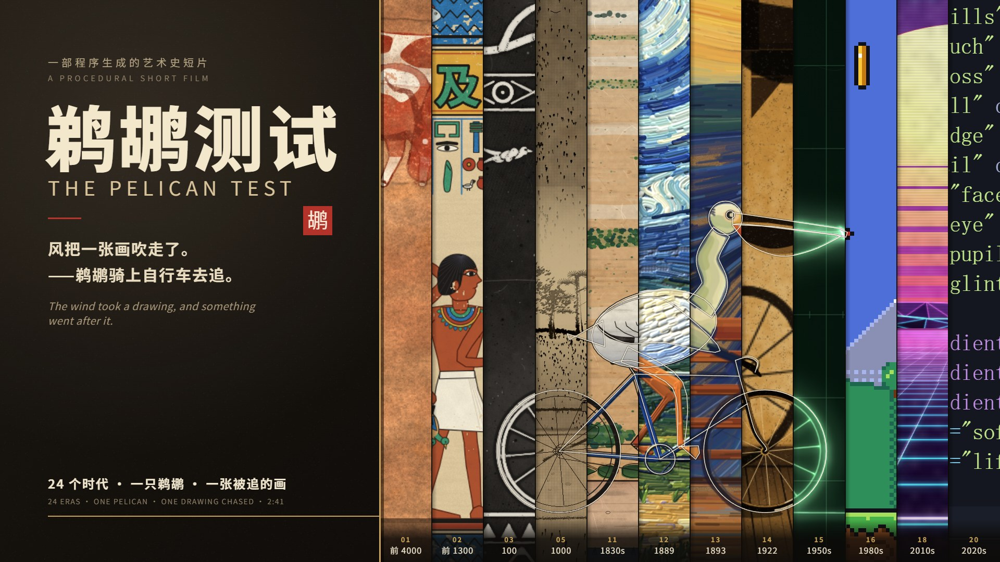
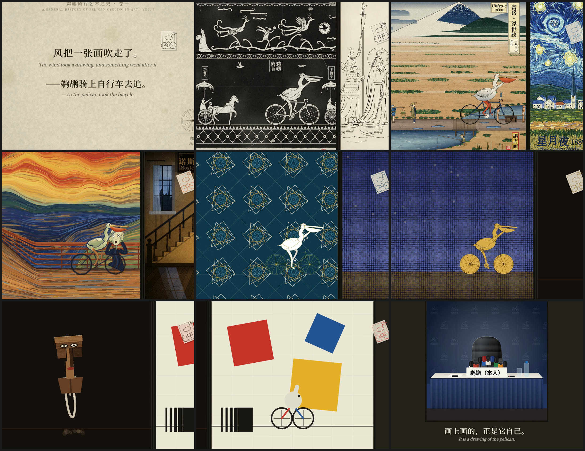

# 鹈鹕测试 · The Pelican Test



> 风把一张画吹走了。鹈鹕骑上自行车去追。
>
> *The wind took a drawing, and something went after it.*

**版本 2.2.3** · 全程序化生成的短片：一只鹈鹕追一张被风吹走的画，穿过 **24 个**时代的画。
每穿过一道画框，世界换一种画法，那张画也被重新画一遍。

**片中没有一张手绘图，也没有一秒录音**——每一帧由 p5.js + p5.brush 算出，每一个音符由 Web Audio 合成。



*九个时刻，从片头一路走到尾声。每格里同时能看到相邻的两道画框，
因为镜头一直在两个时代之间移动。*

| | |
|---|---|
| 时长 | 161 秒（24 格，已渲染成片） |
| 帧数 | 9660 |
| 分辨率 / 帧率 | 1920×1080 @ 60 fps |
| 当前版本 | `2.2.3` · 见 [CHANGELOG.md](CHANGELOG.md) |

---

## 从这里开始

| 你想做什么 | 读这个 |
|---|---|
| **先看看是什么** | 往下读本页，或直接看 [Releases](https://github.com/mengxing123456789/pelican-test/releases) 里的成片 |
| **把片子跑起来** | [§5 怎么跑起来](#5-怎么跑起来) —— 注意要用分段渲染，不是 `npm run render` |
| **理解它是怎么做的** | [§1 当前架构](#1-当前架构) · [§4 设计](#4-设计它是怎么工作的) |
| **改代码前** | [docs/MEMORY.md](docs/MEMORY.md) —— 十一个会静默失败的坑，踩过才知道 |
| **弄清来源与创作边界** | [docs/PROVENANCE.md](docs/PROVENANCE.md) —— 原作是谁的、v2 改了什么、凭什么说同源 |
| **看每版改了什么** | [CHANGELOG.md](CHANGELOG.md) |
| **当 npm 包用** | [docs/using-as-a-package.md](docs/using-as-a-package.md) |
| **查第三方许可** | [THIRD_PARTY_NOTICES.md](THIRD_PARTY_NOTICES.md) |

### 本页目录

1. [当前架构](#1-当前架构)
2. [技术采样与参考](#2-技术采样与参考)
3. [二十四个时代](#3-二十四个时代)
4. [设计：它是怎么工作的](#4-设计它是怎么工作的)
5. [怎么跑起来](#5-怎么跑起来)
6. [与 v1 的差异](#6-与-v1-的差异)
7. [原作者与致谢](#7-原作者与致谢)
8. [版权](#8-版权)

---

## 1. 当前架构

### 分层

```
┌─────────────────────────────────────────────────────────────┐
│  src/main/            叙事层：逐帧合成、镜头、序幕、尾声        │
│    film.js            画面 = 时间的纯函数                       │
│    paper.js   ★v2     被追的那张画 + 伸够曲线                   │
│    camera.js          镜头运动与过框推近                        │
│    intro.js / outro.js 序幕与尾声（v2 已改写文本）              │
├─────────────────────────────────────────────────────────────┤
│  src/scenes/          美术层：一格一个文件（24 个）             │
│    index.js           清单：id / 标题 / 年代 / 主色             │
│    01-sahara.js … 20-code.js      原作者                       │
│    21-islamic.js … 24-bauhaus.js  ★v2 新增                     │
├─────────────────────────────────────────────────────────────┤
│  src/rig/             骨架层：二十四种画法共用的同一副骨架       │
│    pelican.js         鹈鹕与自行车的参数化关节 + pose mods      │
│    pen.js             默认钢笔渲染（v2 加 fillInk）             │
├─────────────────────────────────────────────────────────────┤
│  src/kit/             工具层：笔刷封装、烘焙、纸张、文字、数学   │
│    brush.js           对 p5.brush 的封装与逐笔播种              │
│    index.js           bake() / layer() 缓存、K 命名空间         │
├─────────────────────────────────────────────────────────────┤
│  src/beat/            时钟层：全片唯一的时间事实来源             │
│    timeline.js        120 BPM、24 格、161 s、过框落在强拍        │
│    ride.js            骑行位置、曲柄相位、车轮转速              │
├─────────────────────────────────────────────────────────────┤
│  audio/               声音层：全程序合成，无采样                 │
│    score.js           ★v2 重写主题：追逐调                      │
│    eras.js            各时代编配                                │
│    instruments.js     拨弦、编钟、管风琴、芯片音…                │
│    tape.js            蒸汽波磁带（变速变调）                     │
│    engine.js          离线渲染总线                              │
└─────────────────────────────────────────────────────────────┘
```

### 数据流

```
timeline.js (唯一时钟)
      ↓
riderAt(t, scenes) → 骨架 pose → rig/parts → 各场景用自己的技法画
      ↓
film.js 合成：画框 → 各格 → 被追的画 → 文字层
      ↓
puppeteer 截帧 → frames/*.png → ffmpeg + audio/mix.wav → MP4
```

### 工具层

```
tools/
  server.mjs            本地静态服务器（含 Chrome 探测、GPU 启动参数）
  render.mjs            渲染帧序列（多 Chrome 并行，支持 --from/--to/--resume）
  render-segmented.mjs  ★ 分段渲染→编码→删图→拼接（本机唯一可行的出片路径）
  encode.mjs            帧 + 音频 → MP4（★ --start 支持非 0 起点的段）
  audio.mjs             离线合成配乐 → audio/mix.wav
  levels.mjs            逐格响度自动标定 → audio/levels.json
  check.mjs             结构自检（禁用 API、过框节拍、确定性）
  check-frames.mjs      ★ 核验帧序列（帧数/0 字节/断层/PNG 头）
  preview-strip.mjs     ★ 从成片抽帧生成 README 预览图
  shot.mjs / sheet.mjs  单帧截图 / 接触表
  cover.mjs             封面生成
  push-via-api.mjs      ★ git push 被墙时的 API 推送（Git Data API）
  lib/browser.mjs       puppeteer 启动（跨平台 Chrome 路径与 ANGLE 后端）
```

### 三条硬约束

1. **画面是时间的纯函数。** 同一 `t` 渲染两次逐字节相同。禁止 `Math.random()` / `Date.now()`，随机走 `rngAt(t, salt)`。
2. **文字画在独立 2D 层。** p5.brush 会清掉 p5 的 `text()`。
3. **`env.fit()` 由场景自己调用一次。** 调度器再包一层会双重变换。

---

## 2. 技术采样与参考

### 采样了什么（实测数据，不是估算）

| 项目 | 数值 | 怎么测的 |
|---|---|---|
| p5.brush 笔刷成本 | 20–60 笔：3–12 ms；240 笔：55–120 ms；400 笔：140–225 ms | 实际绘制计时 |
| 单帧渲染（RTX 4060 / D3D11） | 稳态 **7–8 fps**（轻格可达 14 fps） | 分段渲染计时 |
| 全片渲染耗时 | 9660 帧约 **55 分钟**（6 worker，分 6 段） | 分段渲染实测 |
| 配乐离线渲染 | 161 s 配乐约 **520–565 s** | `tools/audio.mjs` 计时 |
| 全片 PNG 体积 | 单帧均值 **3.1 MB**，全片约 **29 GB** | 采样 + 分段实测 |
| 分段渲染峰值磁盘 | 单段 1600 帧约 **5 GB** | 分段流程实测 |
| 成片体积 | **333 MB** / 161 s / 9660 帧 | `ffprobe` |
| 积分响度 | **−19.4 LUFS**（自动标定目标），真峰值 −1.1 dBFS | `tools/levels.mjs` + `ebur128` |
| 各格电平 | 24 格经自动标定至同一目标 | 逐格 RMS 计算 |

### 分段渲染解决了什么

| 问题 | 未处理时 | 处理方式 |
|---|---|---|
| 磁盘装不下整片 PNG | 29 GB vs 28 GB 可用，必定写满 | 渲染一段→编码→删 PNG→下一段 |
| 写满时静默失败 | 渲染器记 0 字节帧但仍退出 0 | 每段编码前核验帧数与非空 |
| 段文件命名冲突 | 递增序号 `seg_000` 被第二次运行覆盖，丢 2410 帧 | 改为按**首帧号**命名 |
| 段内序号不连续 | ffmpeg 找 `f00000.png` 报错 | `encode.mjs` 新增 `--start` 传 `-start_number` |

### 参考了什么

| 来源 | 参考了什么 | 没用什么 |
|---|---|---|
| [RoyceBella-commits/The-Pelican-Test](https://github.com/RoyceBella-commits/The-Pelican-Test) | **二十格美术、骨架、时间轴、渲染管线**——本项目的基础 | — |
| [Tunai-0511/meme67-art-history](https://github.com/Tunai-0511/meme67-art-history) | 工作方式：共享绘图工具包 + 每格一文件 + 逐帧渲染 + 无头截帧 + 接触表 | 代码、画面、构图、笑点 |
| [p5.js](https://p5js.org) 2.3.4 (LGPL-2.1) | 绘图运行时 | — |
| [p5.brush](https://github.com/acamposuribe/p5.brush) 2.2.3 (MIT) | 笔刷引擎 | — |

### 二十四个题材的来源

全部为**公有领域传统或风格**的原创致敬，未复制任何具体作品：

撒哈拉岩画（Tassili 岩画传统）· 埃及墓室壁画 · 汉画像石拓片 · 唐代白描 ·
宋代山水（范宽式）· 清明上河图 · 玛雅抄本 · 莫卧儿细密画 · 八大山人写意 ·
爪哇皮影 · 浮世绘（广重东海道）· 星月夜 · 呐喊 · 诺斯费拉图（1922，公有领域）·
示波器矢量图 · 8-bit 平台游戏 · 早期聊天窗口（虚构）· 蒸汽波 ·
竖屏短视频（虚构应用）· 代码美学 ·
**伊斯兰几何 · 拜占庭马赛克 · 非洲面具 · 包豪斯构成**

---

## 3. 二十四个时代

| # | 画风 | 年代 | 这一格的技法问题 | 这一格发生了什么 |
|---|---|---|---|---|
| 1 | 撒哈拉岩画 | c. 4000 BCE | 矿物颜料压在砂岩上 | 牧人和牛群回头围观 |
| 2 | 埃及壁画 | c. 1300 BCE | 平面矿物色 + 正身侧面 | 摆出标准埃及姿势 |
| 3 | 汉画像石拓片 | c. 100 CE | 黑底白线的反向绘制 | 混进车马出行队伍 |
| 4 | 唐代白描 | c. 750 | 纯线，无渲染 | 吴带当风，衣带翻飞 |
| 5 | 宋代山水 | c. 1000 | 皴法堆叠山体 | 推镜才看清山路上有个小人 |
| 6 | 清明上河图 | c. 1100 | 长卷散点透视 | 骑上虹桥，路人回头 |
| 7 | 玛雅抄本 | c. 1200 | 点横数字记数 | 旁人数它踩了多少圈 |
| 8 | 莫卧儿细密画 | c. 1600 | 多视角并置 | 宾客从好几个视角同时围观 |
| 9 | 八大山人 | c. 1690 | 极简留白 | 翻了一个八大式白眼 |
| 10 | 爪哇皮影 | c. 1800 | 镂空 + 操纵杆 | 车轮一顿一顿地转 |
| 11 | 浮世绘 | 1830s | 木版套色 | 富士山下赶路的人回头 |
| 12 | 星月夜 | 1889 | 厚涂涡旋 | 夜空跟着车轮转 |
| 13 | 呐喊 | 1893 | 表现主义扭曲 | 呐喊者被吓了一跳 |
| 14 | 诺斯费拉图 | 1922 | 剪影 + 阶梯透视 | 影子自己爬上楼梯 |
| 15 | 示波器 | 1950s | 荧光余辉矢量线 | 转错旋钮，扭成李萨如图 |
| 16 | 8-bit 像素 | 1980s | 限色像素网格 | 跳坑、吃金币、1UP |
| 17 | 早期聊天窗口 | 2000s | 256 色抖动 | 被发成动图，窗口抖动 |
| 18 | 蒸汽波 | 2010s | 渐变 + 透视网格 | 世界慢放，磁带跳针 |
| 19 | 竖屏短视频 | 2020s | 9:16 收窄 | 定格、慢放、点赞爆满 |
| 20 | 代码美学 | 大模型时代 | SVG 逐行绘制 | 被一行行代码画出来 |
| **21** | **伊斯兰几何** | c. 1450 | **没有主体：规则即题材** | 图案绕开它，像绕开一个洞 |
| **22** | **拜占庭马赛克** | c. 550 | **图像由离散方块构成** | 被镶成金色圣像 |
| **23** | **非洲面具** | c. 1850 | **正面平面造型** | 转过来面对镜头，骑着单轮 |
| **24** | **包豪斯构成** | 1923 | **几何原语组装** | 被拆成圆、条、三角 |

**为什么新增这四格**：原有二十格以"年代推进"为线索，但都共享同一种观看方式（侧影 + 连续表面）。
后四格各自提出了**不同的绘制问题**——没有主体、离散构成、正面造型、原语组装——
这是题材维度的扩展，而不是又添了四个世纪。

---

## 4. 设计：它是怎么工作的

### 共享骨架，二十四种画法

所有时代共用**同一副骨架**（`src/rig/pelican.js`）：身体、车架、曲柄、车轮相位。
每个时代只负责用自己的技法把同一副骨架画出来。所以鹈鹕跨画框时前后两半能严丝合缝——
它从来没换过骨架，只是换了画它的人。

### 三层画布

| 层 | 内容 | 为什么分开 |
|---|---|---|
| 底层 2D | 文字、标题、字幕 | p5.brush 会清掉 `text()` |
| WEBGL | 所有笔刷美术 | p5.brush 必须在 WEBGL 画布上工作 |
| 合成 | 拍平成一张 PNG | 交给编码器的是单一帧 |

### 烘焙

重场景（宋代山水约 200 笔皴法）超出每帧预算十倍以上，所以静态层只画一次，
存进 framebuffer，之后每帧只画动的部分。

### 追逐动作（v2 核心）

`chaseAt(t)` 给出每格的伸够曲线：

```
u < 0.55    reach = 0        正常骑行
u ≈ 0.83    reach = 1        全力伸翅去够
u > 0.93    reach → 0        画被风吹走，够不着
跨格        reach = 0        新一格开始
```

这个「够到一半被截断」就是每格切换的叙事动力。

---

## 5. 怎么跑起来

需要 **Node 20+**、**Google Chrome**、**ffmpeg** 在 PATH 上。

```bash
npm install
npm run dev        # → http://127.0.0.1:5180/  浏览器实时渲染
```

### 出成片

**不要用 `npm run render` 再 `npm run encode`。** 全片 PNG 序列约 29 GB，
本机磁盘装不下，而磁盘写满时渲染器会把失败帧记成 0 字节却仍返回退出码 0
（本项目曾因此产出 1359 个空帧并报告"成功"）。用分段流程：

```bash
npm run audio              # 1. 合成配乐 → audio/mix.wav（约 9 分钟）
npm run render:segmented   # 2. 分段渲染+编码+拼接 → out/pelican-test_1080p60.mp4
npm run preview            # 3. 重新生成 README 的预览图
```

`render:segmented` 的工作方式：渲染一段 → 核验帧数与非空 → 编码成段 →
**立即删除 PNG** → 下一段 → 最后拼接并混入配乐。
峰值磁盘占用从「整片 29 GB」降到「单段约 5 GB」。

```bash
node tools/render-segmented.mjs --seg 1200        # 更小的段
node tools/render-segmented.mjs --from 0 --to 3000  # 只渲一段
node tools/render-segmented.mjs --keep            # 保留 PNG（调试用）
```

> `npm run check:frames` 用于单段核验；分段流程内部已自动执行同样的检查，
> 任一帧为空就拒绝编码，不会把残缺段混进成片。

### 交付前必跑

```bash
npm run check:frames   # 帧序列：帧数、0 字节、断层、PNG 头
npm run check:sync     # 音画同步：24 个切格点上是否有车铃起音
```

`check:sync` 解码**交付的 mp4** 而不是中间产物，所以封装错误也会被抓到。
它抓出过一个真实缺陷：成片声明 161.02 s 音频，实际只装了 134.36 s ——
拼接输入配合 `-shortest` 会把音轨截短。

当前结果：**24/24 个切格点都有车铃起音，平均偏移 6.8 ms**（60 fps 下约 0.4 帧），
最大 30 ms。

### Windows / Linux

原版只面向 macOS，本项目做了三处适配（macOS 行为不变）：

| 原本 | Windows / Linux |
|---|---|
| Chrome 路径写死 macOS | 按平台探测；`CHROME_PATH` 优先 |
| `--use-angle=metal` | Windows 用 `d3d11` + 独显；`PT_SOFTWARE_GL=1` 退回 SwiftShader |
| `protocolTimeout` 180 s | 设为 0（配乐渲染要跑数分钟） |

### 作为 npm 包

见 [docs/using-as-a-package.md](docs/using-as-a-package.md)。
成片从 [Releases](https://github.com/mengxing123456789/pelican-test/releases) 下载。

---

## 6. 与 v1 的差异

v1 = [RoyceBella-commits/The-Pelican-Test](https://github.com/RoyceBella-commits/The-Pelican-Test)
（B 站 [BV1pLnw6YEzq](https://www.bilibili.com/video/BV1pLnw6YEzq/)，19.7 万播放）。

| 维度 | v1 | 当前 |
|---|---|---|
| 叙事动机 | 观光：穿过二十个时代 | **追逐**：风卷走一张画，鹈鹕去追 |
| 片头 | 「人类自古以来就痴迷于画鹈鹕骑自行车」 | 「风把一张画吹走了」 |
| 片尾 | 「截至目前，人类共提交了 20 份答卷」 | 「画上画的，正是它自己」 |
| 主旋律 | 散步调 | **追逐调**：上行模进，不落主音 |
| 被追的画 | 无 | 全程可见，逐格重绘 |
| 追逐动作 | 无 | 每格末伸翅、画飘走 |
| 格数 | 20 | **24**（新增四个题材维度） |
| 片长 | 137 s | **161 s** |
| 平台 | 仅 macOS | + Windows / Linux |

**保留未改**：原有二十格美术、骨架、时间轴节拍、渲染管线、烘焙机制。

### 最近一轮（v2.2.0）改了什么

| 类别 | 改动 |
|---|---|
| **成片** | 24 格版首次渲染完成：9660 帧 / 161.02 s / 333 MB |
| **配乐** | 补上四个新格的编配（原先这 24 秒是静音）；逐格响度自动标定 |
| **工具** | 分段渲染 `render-segmented.mjs`、预览图 `preview-strip.mjs`、帧核验 `check-frames.mjs` |
| **修复** | `encode.mjs` 缺 `-start_number`；段文件名递增导致覆盖丢帧 |
| **文档** | README 重写（架构图、实测数据、参考来源）、新增 CHANGELOG、预览图 |

详见 [CHANGELOG.md](CHANGELOG.md) 与 [docs/PROVENANCE.md](docs/PROVENANCE.md)。

---

## 7. 原作者与致谢

### 本仓库的基础

**本项目的二十格美术、共享骨架、时间轴、渲染管线出自
[RoyceBella-commits/The-Pelican-Test](https://github.com/RoyceBella-commits/The-Pelican-Test)。**

它也是 B 站那支 19.7 万播放视频的来源——已用配乐互相关验证（相关 **0.9995**）。

原始版权声明：代码 MIT，影片及画面、音频 © 2026 Royce Bella 保留所有权利。
本仓库完整保留这些声明。

### 方法论来源

上述项目的工作方式参考了 **Tunai-0511** 的开源项目
**[meme67-art-history](https://github.com/Tunai-0511/meme67-art-history)**（MIT）：
共享绘图工具包 + 每格一文件 + 按时间逐帧渲染 + 无头截帧 + 接触表自查。

两者均**未使用**该项目的代码、画面、构图或笑点。

### 第三方库

| 组件 | 协议 |
|---|---|
| [p5.js](https://p5js.org) 2.3.4 | **LGPL-2.1**（动态加载，未修改）|
| [p5.brush](https://github.com/acamposuribe/p5.brush) 2.2.3 | MIT，© Alejandro Campos Uribe |
| simplex-noise | MIT，© Jonas Wagner |
| puppeteer-core 25.x | Apache-2.0（开发依赖）|
| ffmpeg | LGPL/GPL（未分发）|

完整说明见 [THIRD_PARTY_NOTICES.md](THIRD_PARTY_NOTICES.md)。

---

## 8. 版权

- **代码**：MIT，见 [LICENSE](LICENSE)，© 2026 Royce Bella
- **影片本身**（画面、成片、渲染音频、`media/` 内图片）：© 2026 Royce Bella，保留所有权利
- **v2 改动部分**（叙事文本、主题旋律、`paper.js`、四个新场景）：同样许可

---

**English**: *The Pelican Test* — a procedurally generated film in which a pelican chases a
drawing the wind took, through 24 eras of art, each of which re-draws the drawing and the pelican
in its own medium. Every frame is a pure function of time (p5.js + p5.brush); all music is
synthesised with Web Audio. Built on
[RoyceBella-commits/The-Pelican-Test](https://github.com/RoyceBella-commits/The-Pelican-Test),
which learned its method from
[Tunai-0511/meme67-art-history](https://github.com/Tunai-0511/meme67-art-history).
v2 rewrites the narrative, text and theme, adds the chased drawing and four new traditions.
Code MIT; the film is © 2026 Royce Bella.
